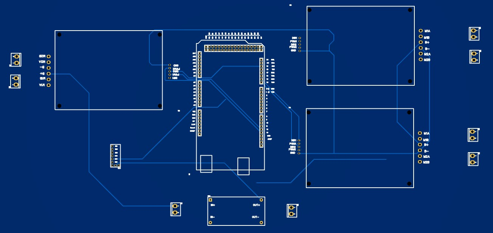

# Mars Rover – Mongol Tori

Electronics design and Arduino Mega control sketch for the Mongol Tori rover. The hardware images show an RC receiver, three dual-channel motor-driver interfaces, and an adjustable power converter.

The sketch contains left/right drive mixing, neutral arming, signal-loss shutdown, and speed ramping. All configuration, control functions, and compile-time checks are included in the single sketch; no companion headers are needed.

[View the schematic](hardware/Sch-MT.jpg) · [View the PCB layout](hardware/PCB-MT.jpg)

## Repository materials

| Material | Location |
| --- | --- |
| Circuit schematic | [Sch-MT.jpg](hardware/Sch-MT.jpg) |
| PCB layout | [PCB-MT.jpg](hardware/PCB-MT.jpg) |
| Board preview | [3D-MT.jpg](hardware/3D-MT.jpg) |
| Control sketch | [MongolToriMega.ino](firmware/MongolToriMega.ino) |
| Firmware status and pin reference | [Firmware guide](firmware/README.md) |
| Components and wiring | [Hardware notes](docs/HARDWARE.md) |
| Build preparation and checks | [Build notes](docs/BUILD_NOTES.md) |

## Current status

The sketch is self-contained and targets Arduino Mega 2560. Motor outputs remain disabled until `ROVER_CONFIGURATION_CONFIRMED` is set to `1` after checking the settings at the top of the file.

Before operation, confirm motor grouping, polarity, driver mode, and receiver settings. Hardware operation remains untested. Editable PCB files are not included.

