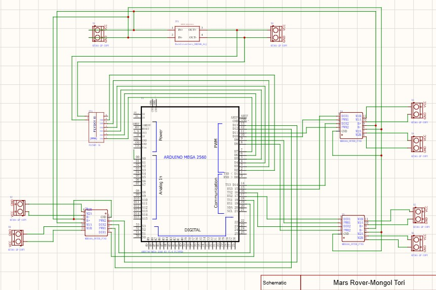

# Hardware notes

[Back to the project overview](../README.md)

## Components shown

| Component | Quantity | Role |
| --- | ---: | --- |
| Arduino Mega 2560 | 1 | Main controller. |
| RC receiver | 1 | Command inputs. |
| Dual-channel motor-driver interface | 3 | Six motor-output channels. |
| Adjustable buck converter | 1 | Power conversion. |
| Motor-output terminal pair | 6 | Motor connections. |

These quantities describe the images, not a verified parts list for an assembled rover.

[Full-size schematic](../hardware/Sch-MT.jpg) · [PCB layout](../hardware/PCB-MT.jpg) · [Board preview](../hardware/3D-MT.jpg)

## Wiring status

The receiver channels connect to D2–D7. Driver PWM and direction connections are listed in the [firmware pin reference](../firmware/README.md#pins-from-the-schematic).

Confirm the actual driver models, control modes, wheel assignments, polarity, battery voltage, and motor stall currents. Converter settings and PCB current capacity remain unverified. Editable circuit, PCB, and mechanical files are not included.
